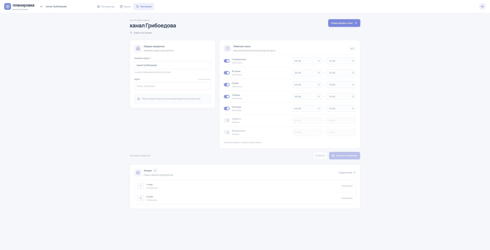
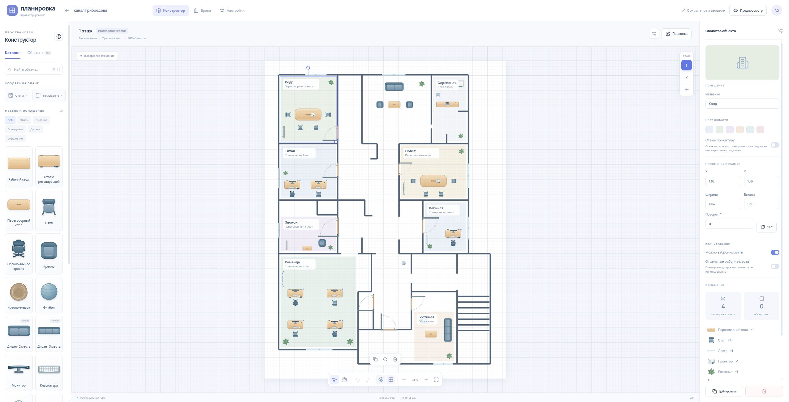
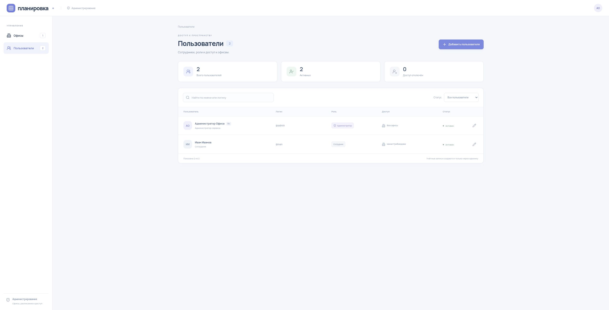
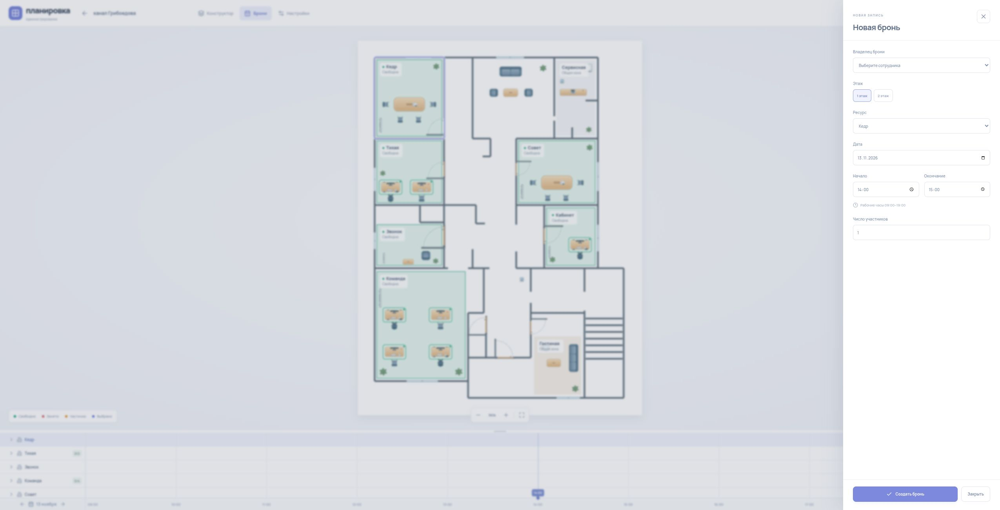

# Руководство администратора

Порядок настройки: офис → карта → рабочие часы → доступ сотрудников.
Для собственной брони —
[руководство сотрудника](USER-GUIDE.md).

## Открыть админку

Адрес приложения и первый администраторский вход выдаёт ответственный
за установку. Войдите, нажмите аватар справа сверху → **«Администрирование»**.
Раздел **«Офисы»** отвечает за пространство, **«Пользователи»** — за сотрудников.
Вернуться к карте можно через меню профиля → **«К бронированию»**.

## Создать офис и задать часы

1. В **«Офисах»** нажмите **«Добавить офис»**, введите название
   и необязательный адрес → **«Создать офис»**.
2. Откройте офис: **«Конструктор»** — карта, **«Брони»** — расписание,
   **«Настройки»** — название и рабочие часы.
3. В **«Настройках» → «Рабочие часы»** включите рабочие дни, задайте
   начало и окончание каждого дня → **«Сохранить изменения»**.

Время московское; бронь должна помещаться в рабочие часы.
Изменение графика сохраняет старые брони с пометкой, если они нарушают
новые условия. Исправление описано в разделе «Управлять бронями» ниже.

## Подготовить карту этажа

Откройте **«Конструктор»**. Слева — каталог объектов, в центре — карта,
справа — свойства выбранного объекта.

1. Выберите этаж кнопками справа; **«+»** добавляет новый.
   Название меняется через **«Настройки этажа»**.
2. **Если есть готовый план:** откройте **«Подложка» → «Загрузить изображение»**
   (PNG, JPEG, WebP). Подложка — картинка плана этажа, например схема эвакуации:
   она помогает расставить помещения и мебель по реальному расположению.
   Без картинки можно сразу рисовать на пустой карте.
3. Если загрузили картинку, подвиньте её и тяните за углы,
   чтобы мебель подходила к ней по размеру.
   Появившийся стул — образец из каталога для сравнения масштаба;
   после **«Готово»** он исчезнет. Для повторной настройки —
   **«Подложка» → «Редактировать подложку»**.
4. Создайте области комнат на пустой карте или поверх загруженной картинки:
   нажмите **«Помещение»**, нарисуйте прямоугольник мышью и задайте
   название справа. Эти области сотрудники будут выбирать для брони.
   **«Стены по контуру»** рисуют границы области;
   отключите их, если стены уже видны на картинке.
5. Для конкретного рабочего места перетащите из каталога **«Рабочий стол»**
   или **«Стол с регулировкой»**. Внутри комнаты проверьте поле **«Помещение»**
   справа: оно связывает стол с комнатой. В открытой зоне оставьте **«Вне помещения»**.
6. Включите **«Можно забронировать»** у нужной комнаты или стола.
   Чтобы столы внутри бронировались отдельно, включите у комнаты
   **«Отдельные рабочие места»**. Бронь комнаты целиком займёт и её столы.

Добавьте стулья и технику. В свойствах комнаты видны оснащение и число
сидячих мест; стул увеличивает вместимость, а отдельную бронь создают на стол.

Двигайте объекты мышью, размеры меняйте справа. Карту двигайте с зажатым
пробелом; **+ / −** меняют масштаб, **«Вписать план»** показывает весь этаж.
Другие сочетания — **«Горячие клавиши»**.

Изменения сохраняются автоматически: дождитесь **«Сохранено на сервере»**.
При ошибке нажмите **«Повторить сохранение»**. При конфликте с другим окном —
**«Открыть актуальный план»**. Черновик — сохранённая копия ваших правок:
**«Отбросить черновик»** оставит открытый серверный план,
**«Восстановить черновик»** заменит его вашей копией. Чтобы сохранить изменения
другого администратора, оставьте серверный план и внесите свои правки заново.

## Добавить сотрудника и выдать доступ

В **«Пользователях» → «Добавить пользователя»** заполните имя, фамилию,
логин, пароль от восьми символов, роль и **«Доступ к офисам»** →
**«Создать пользователя»**. Пароль передайте сотруднику лично.
Сотрудник видит отмеченные офисы; без назначений карта недоступна.
Администратору доступны все офисы.

Для изменений нажмите карандаш напротив сотрудника.

- Забытый пароль: **«Установить новый пароль»**, введите и повторите его →
  **«Сохранить новый пароль»**. Потребуется новый вход.
- Убрать один офис: снимите его галочку и сохраните.
- Отключить сотрудника: выключите доступ в карточке, сохраните
  и подтвердите **«Отключить доступ»**.

Утрата доступа отменяет будущие и завершает текущие брони затронутых офисов;
история сохраняется. Если показано **«Отзыв доступа выполняется»**,
дождитесь **«Отзыв доступа завершён»**.

## Управлять бронями

В офисе откройте **«Брони»**, выберите дату и этаж → **«Новая бронь»**.
**«Владелец брони»** — сотрудник, для которого вы её создаёте.
Выберите ресурс — конкретную комнату или место, время и число участников
комнаты → **«Создать бронь»**.

Нажмите полосу в расписании для редактирования. Перетаскивание переносит бронь,
края полосы меняют длительность. Можно менять записи любых сотрудников,
но пересечения ресурсов запрещены. **«Отменить бронь»** освобождает будущий
интервал, **«Завершить сейчас»** — остаток текущего.

Кнопка **«История»** открывает отменённые записи и **«Требуют внимания»**.
У такой брони изменились условия, но время всё ещё занято:
прочитайте причину, исправьте комнату/место или время либо отмените запись.
При отказе сохранения исходная бронь остаётся.

