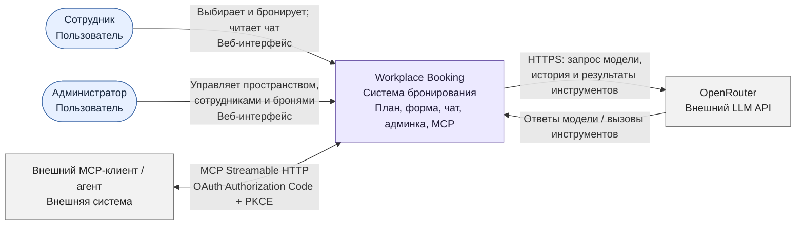
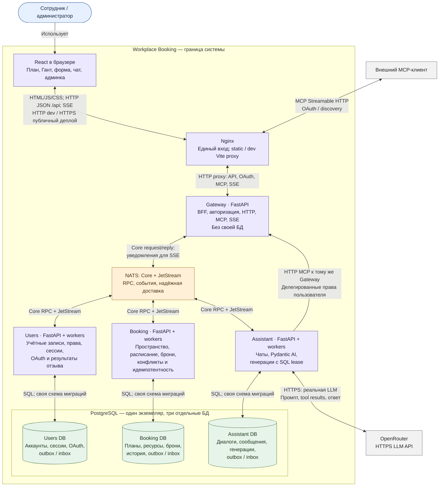

# Архитектура: C1 и C2

Редакция: 12.11.2026. Схемы для сдачи по
[исходному заданию](docs/source/assignment.md). Границы системы и владение
данными приняты в [журнале решений](docs/decisions.md); протоколы ниже
сверены с [реализованным RPC](docs/implementation/service-rpc.md) и
[состоянием сервисов](docs/implementation/services-status.md).

## C1 — контекст системы

Сервис помогает сотрудникам бронировать конкретные рабочие места и
переговорные на планах этажей. Администратор управляет сотрудниками,
доступом, зданиями, планами и бронями. Встроенный чат использует реальную
LLM через OpenRouter; сторонний агент подключается к публичному MCP.

Сторонний клиент получает права сотрудника, без административных инструментов.
Предложение помощника не удерживает ресурс и не создаёт бронь. Встроенный
чат открывает общую форму; внешний клиент получает ссылку на неё. Пользователь
подтверждает конкретные параметры, после чего сервер снова проверяет права
и занятость. Ошибка AI не отключает просмотр плана и ручную форму.

## C2 — контейнеры и взаимодействие

Четыре Python/FastAPI-сервиса независимо развёртываются из монорепозитория.
Снаружи доступен один Nginx. В production он отдаёт собранный React, в dev
проксирует Vite. React выполняется в браузере. Dev использует HTTP;
для публичного production требуется HTTPS.

**Легенда.** Голубые элементы — люди, фиолетовые — контейнеры приложения,
зелёные цилиндры — постоянные БД, оранжевый — брокер, серые — внешние системы.
Стрелка задаёт направление взаимодействия; двунаправленная связь включает
запрос/ответ либо публикацию/потребление. `workers` — отдельные процессы
того же сервиса и владельца БД, а не дополнительные бизнес-сервисы.

### Ответственность и границы

| Контейнер         | Ответственность                                                                                                  |
| ----------------- | ---------------------------------------------------------------------------------------------------------------- |
| React             | Адаптивный интерфейс, отображение предложения, явное подтверждение формы; типизированный клиент Gateway          |
| Nginx             | Единственный опубликованный вход; маршруты UI, `/api`, `/mcp`, OAuth/discovery и SSE; без бизнес-логики          |
| Gateway           | BFF с публичными camelCase DTO, локальная проверка веб-JWT, роли и объектные права, MCP и авторизованный SSE     |
| Users             | Проверка паролей, сотрудники и доступные здания, выдача/обновление/отзыв сессий и MCP-полномочий                 |
| Booking           | Здания, этажи, планы и ресурсы; правила времени, атомарные конфликты комнаты/мест, идемпотентные брони и история |
| Assistant         | Общий чат пользователя и архив, один активный запуск, Pydantic AI/OpenRouter, подбор только через общий MCP      |
| Три БД PostgreSQL | Отдельные владельцы и миграции; сервис не читает чужие таблицы; outbox лежит в БД владельца изменения            |
| NATS Core         | Обычные внутренние request/reply и уведомления; официальный `nats-py`, RPC subjects не сохраняются JetStream     |
| NATS JetStream    | Долговечные фоновые действия и события; outbox, повторы и идемпотентные потребители, подтверждение после commit  |

Users остаётся источником прав; всю пользовательскую авторизацию выполняет
Gateway. Booking хранит ID владельца брони и проверяет предметные инварианты,
без копий ролей, доступов и реестра отозванных пользователей. Веб-access JWT
живёт две минуты и проверяется локально; возраст веб-сессии сам по себе
не требует повторного логина. MCP использует отдельный OAuth-механизм.

### Существенные потоки

1. **Ручная бронь:** React → Nginx → Gateway → Core NATS → Booking → его БД.
   Проверка конфликта, бронь, ключ подтверждения, история и outbox фиксируются
   одной транзакцией. Повтор того же подтверждения возвращает ту же бронь.
2. **Подбор:** Gateway принимает сообщение через Core NATS в Assistant;
   генерация выполняется отдельным worker по сохранённому запросу с SQL lease.
   Он получает делегацию исходной сессии через Users/Core NATS, вызывает
   OpenRouter и HTTP MCP Gateway. MCP возвращает актуальные данные Booking;
   модель подготавливает форму и не сохраняет бронь.
3. **Отзыв доступа:** Users сохраняет отзыв и outbox; Booking через JetStream
   отменяет будущие и завершает текущие брони, сохраняет результат и публикует
   его своим outbox обратно Users. Публикация брокеру ещё не означает
   завершение отмены; промежуточное состояние видно администратору.
4. **Обновление UI:** события подтверждённых изменений доходят до Gateway
   через NATS, затем идут разрешённому пользователю через SSE. Подписка
   активируется перед загрузкой HTTP-снимков; переподключение повторяет этот
   цикл. Replay всех событий не требуется. Доступ к скрытым зданиям и чужим
   чатам через поток не выдаётся.

Внутренний RPC использует общий envelope и исполняет существующие
FastAPI/Pydantic-обработчики через `httpx.ASGITransport` **внутри процесса**.
Сетевой HTTP-переход Gateway → Users/Booking/Assistant заменён NATS;
Assistant → Gateway MCP и Assistant → OpenRouter остаются HTTP.
Автоматического повтора неоднозначной записи после RPC-тайм-аута нет.

## Подтверждённое состояние и границы проверки

На 12.11.2026 отчёт [сервисов](docs/implementation/services-status.md) фиксирует
работающий локальный Docker-стенд, Core NATS, PostgreSQL, JetStream/outbox,
OAuth/MCP и изолированные автотесты с настоящими БД и брокером. В этих
автотестах модель детерминированная; они не являются проверкой платного LLM.

[Живой прогон](docs/implementation/live-assistant.md) отдельно подтверждает
реальный OpenRouter → MCP → заполненная форма → подтверждённая бронь → архив
чата через локальный Nginx. Выбранный пользователем alias модели —
`~deepseek/deepseek-flash-latest`; фактическая обслужившая версия записана
в отчёте. Контрольная бронь после проверки отменена с сохранением истории.

Адреса и операторские отчёты конкретного размещения находятся вне публичной
документации. При новом запуске HTTPS и готовое стороннее OAuth/MCP-приложение
проверяются отдельно от локального production smoke. Требование исходного
задания о доступном приложении с формой и реальным чатом сохраняется.

## Подробные материалы

- [Архитектурная основа](docs/architecture.md), [пять ТЗ](docs/README.md#пять-тз)
  и [очередь оставшихся уточнений](docs/questions.md).
- [RPC: subjects, envelope, сбои и альтернативы](docs/implementation/service-rpc.md).
- [Публичный Gateway и решения BFF/OAuth](docs/implementation/gateway-contract.md),
  [SSE и интеграция фронта](docs/implementation/backend-handoff.md).
- [Решения реализации сервисов](docs/implementation/service-decisions.md),
  [данные и инварианты Booking](docs/implementation/booking-service.md),
  [рантайм и worker Assistant](docs/implementation/assistant-runtime-handoff.md).
- [Docker dev/prod и запуск](README.md).
