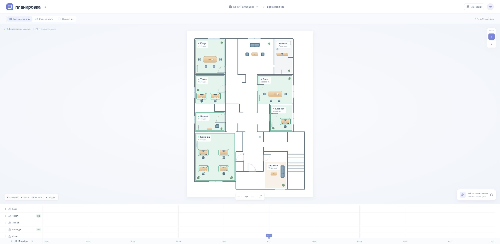
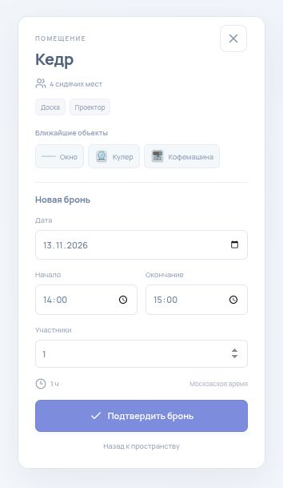
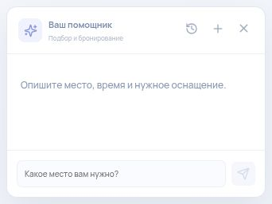

# Руководство сотрудника

Бронируйте конкретное рабочее место для себя или помещение целиком.
[Руководство администратора](ADMIN-GUIDE.md).

## Начало работы

Адрес приложения, логин и пароль выдаёт администратор. Откройте этот адрес
и войдите. Если забыли пароль или нужного офиса нет, обратитесь к администратору.

Вверху выберите офис, справа на карте — этаж. Фильтры **«Рабочие места»**
и **«Помещения»** оставляют нужный тип. Карту можно двигать и масштабировать
кнопками **+ / −**, на телефоне — перемещать пальцем.

## Как читать занятость

Выберите дату внизу. Нажмите часовую линейку или перетащите маркер с часами:
карта покажет занятость **в выбранный момент**.

| Обозначение | Значение |
| --- | --- |
| Зелёный | Свободно |
| Красный | Занято |
| Оранжевый | Часть отдельных мест комнаты занята |
| Фиолетовая рамка | Выбранное вами место или помещение |

В расписании внизу раскройте комнату стрелкой слева: появятся отдельные
места и полосы броней — занятые отрезки времени. Нажмите полосу, чтобы
увидеть время и владельца.

Зелёный цвет в 10:00 ещё не означает, что место свободно до 11:00:
при бронировании проверяется весь выбранный интервал.

## Создать бронь

1. Для всей комнаты нажмите её область на карте. Для одного места —
   конкретный стол либо название места в раскрытом расписании.
   В карточке проверьте подпись **«ПОМЕЩЕНИЕ»** или **«РАБОЧЕЕ МЕСТО»**
   и оснащение. Для уединения выбирайте комнату целиком.
2. Нажмите **«Забронировать»** либо **«Выбрать другое время»**.
3. Укажите дату, **«Начало»**, **«Окончание»**, для комнаты — **«Участники»**:
   сколько человек будет пользоваться помещением.
4. Проверьте параметры → **«Подтвердить бронь»**.

После сохранения форма закроется, расписание покажет вашу бронь.
До подтверждения место могут занять другие: при конфликте измените
время или выберите другое место.

Все часы московские. По умолчанию доступны сегодня и ещё шесть дней,
шаг — пять минут; бронь целиком помещается в рабочие часы одного дня.
Предупреждение о нехватке сидячих мест не запрещает бронь комнаты.

## Изменить или отменить

Откройте **«Мои брони»** вверху, выберите запись → **«Изменить бронь»**,
исправьте параметры → **«Сохранить изменения»**. Свою будущую бронь можно
перенести полосой в расписании, длительность — изменить её краями.
Чужие записи можно только просматривать.

У начавшейся брони меняется только окончание. **«Отменить бронь»** освобождает
будущий интервал, **«Завершить сейчас»** — остаток текущего; история сохраняется.

Пометка о пересмотре означает изменение условий, например рабочих часов.
Откройте запись, прочитайте причину, исправьте время/место либо отмените бронь.
До этого её интервал остаётся занят.

## Помощник

Нажмите **«Найти с помощником»** справа снизу и опишите запрос:
«Переговорная на троих завтра с 10 до 11 с доской».
Помощник уточнит данные и откроет форму. **Проверьте её и подтвердите сами.**
Если помощник недоступен, используйте карту и форму.

Пока идёт ответ, новое сообщение отправить нельзя. Крестик сворачивает окно,
сохраняя диалог и набранный текст. Любая созданная вами бронь завершает текущий
диалог и сохраняет его в архив. Значок часов **«История диалогов»** открывает
архив для чтения; **«Новый диалог»** (＋) начинает обращение с чистого листа.

## Профиль

Нажмите инициалы справа вверху → **«Мой профиль»**, чтобы сменить пароль.
После смены войдите заново на всех устройствах. **«Выйти»** — в том же меню.
