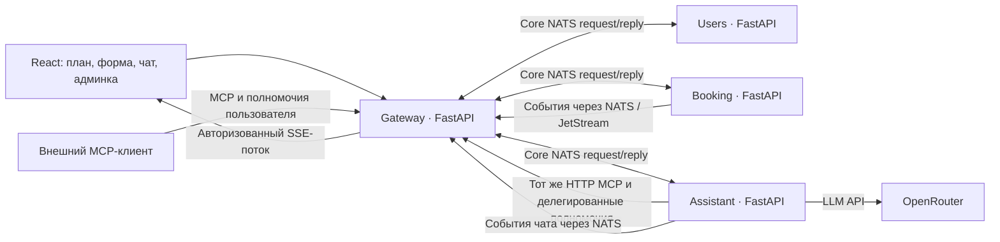

# Архитектура

Текущее распределение: четыре независимо развёртываемых FastAPI-сервиса
и собственный React-фронтенд. Основание — D-014 в [журнале решений](decisions.md).
Конкретные контракты уточняются через [очередь вопросов](questions.md).

## Компоненты

| Компонент | Ответственность и владение                                                                                                                       |
| --------- | ------------------------------------------------------------------------------------------------------------------------------------------------ |
| Frontend  | Наш адаптивный интерфейс плана, формы, чата и админки; основной поток бронирования на компьютерах и телефонах; отображение предложения помощника |
| Gateway   | Публичный HTTP- и MCP-вход; вся авторизация, проверки прав и маршрутизация; удостоверенный контекст и авторизованные SSE-события                 |
| Users     | Учётные записи, проверка пароля, состояние пользователя, роли; владение, выдача, хранение и отзыв сессий                                         |
| Booking   | Этажи, планы, ресурсы и брони; предметные проверки времени, состояния ресурсов, занятости и пересечений, идемпотентность и сохранение            |
| Assistant | Pydantic AI внутри FastAPI; промпты, чат-сессии и история, OpenRouter и вызовы MCP с пользовательскими полномочиями                              |

MCP — интерфейс Booking к тому же прикладному слою, что используется HTTP API.
Отдельного сервиса и копии броней для него нет. Пространство и бронирование
остаются двумя предметными доменами внутри Booking.

## Хранение данных

Для тестового выбран один экземпляр PostgreSQL и три отдельные БД:
Users, Booking и Assistant, со своими учётными данными и миграциями — D-113.
Gateway собственной БД не имеет; сессиями владеет Users. Сервисы обращаются
к чужим данным через API или сообщения, без прямого чтения и изменения
чужих таблиц. Outbox хранится в БД владельца изменения.

Микросервисы обусловлены заданием: исходно требуется минимум два
независимо развёртываемых сервиса, четыре — выбранная нами декомпозиция.
Для этого масштаба пользователь предпочёл бы обойтись без такого разделения,
если бы оно не требовалось условиями тестового.

## Внутренний транспорт

Обычные внутренние вызовы Gateway → Users/Booking/Assistant используют
Core NATS request/reply — D-124. Ответ возвращается через NATS;
сервисы также могут публиковать независимые события. Надёжные фоновые
команды и события используют JetStream с outbox по D-111 и D-112.
Core и JetStream работают на одном сервере; RPC и reply subjects
не включаются в сохраняемые потоки.

Публичные HTTP API, MCP и SSE остаются на Gateway. Встроенный Assistant
использует тот же HTTP MCP-вход; за этой границей Gateway вызывает
нужную сервисную операцию по NATS. Внешний API OpenRouter также сохраняет
свой HTTP-протокол. Стек Python/FastAPI сервисов не заменяется.
Готовая Python-обвязка, тайм-ауты, ошибки и форматы внутренних сообщений
ещё конкретизируются.

## Вход и контекст доступа

Пользователь входит через gateway, учётные данные проверяет Users.
Gateway получает удостоверенный контекст и передаёт его прикладным сервисам.
Users выдаёт, хранит и отзывает сессии — D-109.
Для веба выбран короткий подписанный JWT с локальной проверкой в Gateway,
без запросов к Users/NATS на каждом защищённом запросе — D-116.
Users участвует во входе и обновлении. Двухминутное обновление конкретизируется
как access JWT со сроком две минуты; передача в cookie допустима.
Автоматического выхода по возрасту веб-сессии нет — D-123. Короткий JWT
обновляется в фоне, пока сессия разрешена. Явный выход, отключение аккаунта
и отзыв при смене/сбросе пароля остаются причинами повторного входа.

При отключении аккаунта Users прекращает обновление, уже выданный веб-JWT
может действовать до истечения короткого срока. Это уточняет прежнее
требование немедленного веб-отзыва из D-061. Последствия для смены пароля,
ролей, доступа к зданию, открытого SSE и уже запущенных операций ещё нужно
согласовать. MCP использует отдельно принятый OAuth-поток D-115;
веб-cookie и её срок не переносятся на него автоматически.

Assistant получает делегированные полномочия текущего пользователя
и использует общий MCP-вход без отдельного входа и пользовательской БД.
Владельца операции определяет серверный контекст,
а не свободно заданный моделью аргумент. Пароли и полномочия не включаются
в текст промпта.

Users подтверждает личность, состояние учётной записи и роли.
Gateway выполняет все проверки авторизации и прав на действия и объекты —
D-117. Booking исполняет разрешённые команды и проверяет предметные правила;
учётные записи, роли и состояние блокировки пользователей в нём не копируются.
Доверенный контракт внутренних вызовов и получение Gateway необходимых
фактов о ресурсе и владельце ещё уточняются в Q-14.

## Общий прикладной слой HTTP и MCP

HTTP API и MCP применяют одни правила доступа, независимо от вида клиента.
MCP показывает доступные пользователю инструменты; при исполнении каждого
вызова Gateway проверяет полномочия и доступ к объекту — D-117.
MCP повторяет операции бэка клиентского интерфейса сотрудника, включая
проверки прав; административные операции в этот объём не добавляются — D-103.

Личные операции привязаны к пользователю. Каталог и необходимая занятость
ресурсов общие в пределах его доступа. Проверка конфликтов учитывает
брони всех пользователей одного ресурса.
Доступ пользователей разграничивается по зданиям — D-085, уточняющий
прежний общий доступ из D-023. HTTP и MCP проверяют права на здание
целевого ресурса. Администратор назначает пользователю список зданий;
внутри доступны все этажи и ресурсы, остальные здания скрыты. При отзыве
доступа будущие брони в этом здании отменяются, текущие прекращаются сразу —
D-089. Право отмены чужой брони остаётся отдельным.
История хранится, но после отзыва доступа к зданию не показывается
пользователю, включая его собственные записи; полный отзыв учётной записи
закрывает весь доступ — D-100. Правила одинаковы для UI, HTTP и MCP.

Единый удалённый MCP доступен внешним клиентам уже в первой версии — D-053.
Наш Assistant использует тот же контракт, без отдельного привилегированного
бизнес-API. Gateway предоставляет вход, Users удостоверяет пользователя,
Booking реализует инструменты и все предметные проверки.

Для подключения внешних клиентов выбран OAuth 2.1,
Authorization Code + PKCE с метаданными обнаружения — D-115, по
[MCP Authorization](https://modelcontextprotocol.io/specification/2026-07-28/basic/authorization).
Логин и пароль вводятся на стороне нашей системы; полномочия клиента
относятся к той же учётной записи. Контракты токенов, реализация выдачи
и делегирования и клиентская совместимость уточняются в Q-14;
сам выбор протокола уже закрыт.

Публичный и внутренний маршруты используют одинаковый MCP-контракт
и права пользователя. Запросы встроенного клиента не обязаны выходить
в публичный интернет, если тот же вход доступен через внутренний адрес.
Поддерживаемые версии
[Streamable HTTP](https://modelcontextprotocol.io/specification/2026-07-28/basic/transports/streamable-http)
и клиентская совместимость ещё не выбраны. Отдельный поток SSE занятости
ниже не является MCP-транспортом.

## Обновление занятости

Выбран SSE без long polling — D-048. Booking является источником
подтверждённых изменений броней, gateway предоставляет фронтенду
авторизованный поток. Создание, перенос, изменение и отмена обновляют
план и Гант, включая занятость связанных комнаты и рабочих мест.

События отправляются по результату успешного сохранения. После разрыва
и переподключения клиент загружает актуальный снимок — D-110;
воспроизведение каждого пропущенного события не требуется.
Контракт должен обеспечивать обработку повторов. Переход от снимка к потоку
не должен терять изменения. При прекращении доступа выдача событий
пользователю прекращается.

Идентификаторы и переподключение описаны в
[WHATWG SSE](https://html.spec.whatwg.org/dev/server-sent-events.html).
Для надёжных межсервисных сообщений выбран NATS JetStream — D-111.
Схема событий и согласование снимка с потоком ещё выбираются в Q-09.

## Общий диалог и его обновления

Assistant владеет одним активным диалогом пользователя, общим для всех
вкладок. Его сообщения, ответы и архивирование синхронизируются через
авторизованный SSE-поток Gateway — D-105. События общего чата относятся
к текущему пользователю. После переподключения загружается актуальный снимок
чата без повторной генерации — D-110. Схемы событий и согласование снимка
с потоком обсуждаются в Q-13. Привязка событий чата к внутреннему транспорту
проектируется отдельно от надёжных бизнес-команд через JetStream.

## Межсервисные действия при сбое

NATS JetStream выбран для надёжных межсервисных сообщений — D-111.
Если Users отключил сотрудника, а Booking временно недоступен, состояние
аккаунта и запрет обновления фиксируются сразу; веб-доступ ограничен сроком
короткого JWT по D-116. Задача отмены броней сохраняется и выполняется
с повторами. До завершения администратор видит промежуточное состояние.
Обработчик подтверждает сообщение после сохранения результата и безопасно
обрабатывает повторную доставку.
Локальная граница отзыва пользователя в Booking отвергнута — D-117.
Ускоренный отзыв можно реализовать в Gateway через уведомление и хранилище
отозванных контекстов, например Redis. Это возможное улучшение, а не
выбранная обязательная зависимость. По умолчанию сохраняется компромисс
с коротким веб-JWT без обращения к Users/NATS на каждом запросе.

Для согласования изменения данных и публикации выбран transactional
outbox — D-112. Сервис-владелец сохраняет изменение и событие одной
транзакцией; отправитель публикует событие в JetStream и отмечает отправку
после подтверждения брокера. Повтор сохраняет идентификатор события.

Параметры потоков и потребителей, схема outbox, порядок сообщений
и контракты результата ещё обсуждаются в Q-12.

## Изоляция отказов AI

Рантайм Assistant — Pydantic AI внутри нашего FastAPI-сервиса — D-114.
API, хранение состояния и принятый жизненный цикл чата остаются нашей
обвязкой. Конкретную модель OpenRouter пользователь выберет позже — D-107.
В контекст модели передаётся окно последних сообщений активного диалога:
старые сообщения обрезаются, полная история сохраняется в БД — D-122.
Автоматическое резюме и принудительный новый диалог из-за объёма
не добавляются.

Просмотр и форма обращаются через gateway к Booking, без зависимости
от Assistant и OpenRouter. Отказ AI не отключает этот маршрут.

Подтверждение встроенного и внешнего помощника выполняется через нашу форму;
для внешнего клиента MCP возвращает ссылку — D-054.
Результат подтверждения показывается в нашем интерфейсе; автоматический
возврат во внешний чат не требуется — D-121.
Параметры предзаполнения размещаются в URL без таймера и отдельной записи
предложения в БД; ссылку можно сохранять в закладки — D-118.
Текущий пользователь подтверждает конечные параметры с обычными проверками
прав в Gateway и предметных правил в Booking. Для подтверждения выбран
клиентский ключ идемпотентности, сохраняемый с бронью, — D-120.
Повтор одной отправки возвращает ту же бронь. Идентификаторы запросов
и трассы отделены от ключа операции и позволяют связать её попытки
и внутренние сообщения. Формат URL, точные контракты ключа и корреляции
ещё уточняются в Q-04.
Хранение диалогов рассматривается в Q-13, выбор рантайма и ограничения
его работы — в Q-15. Проектируемые сущности описаны в
[предметной модели](domain-model.md).

Это рабочая схема целевой системы. Требования по компонентам и приёмка
описаны в [пяти ТЗ](README.md#пять-тз); оставшаяся конкретизация контрактов —
в [очереди](questions.md). Обязательные C1/C2 для сдачи оформляются на этой
основе и сверяются с фактической реализацией.
